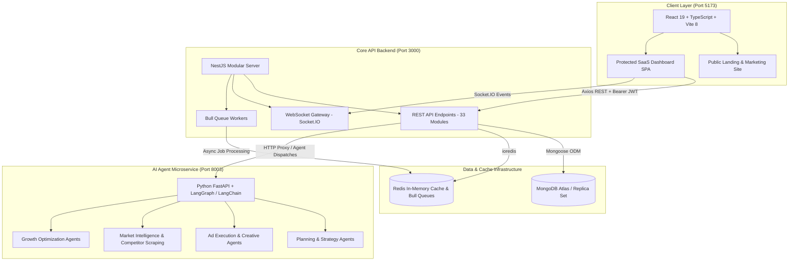

# 🚀 Wheedle AI — AI Digital Marketing Platform (V2)

[](https://react.dev/)
[](https://vitejs.dev/)
[](https://tailwindcss.com/)
[](https://nestjs.com/)
[](https://www.typescriptlang.org/)
[](https://fastapi.tiangolo.com/)
[](https://python.org/)
[](https://www.mongodb.com/)
[](https://redis.io/)

> **Wheedle AI** is an enterprise-grade, autonomous **AI-Powered Digital Marketing SaaS Platform**. It unifies multi-channel ad management, autonomous agent orchestration, CRM & lead scraping, review & reputation management, conversational AI bot builders, and predictive campaign analytics under one modern, real-time operating system.

**🌐 Live Production:** [https://wheedletechnologies.tech](https://wheedletechnologies.tech)

---

## 📑 Table of Contents

- [System Architecture](#-system-architecture)
- [Key Features & Capabilities](#-key-features--capabilities)
- [Tech Stack Overview](#-tech-stack-overview)
- [Directory Structure](#-directory-structure)
- [Getting Started](#-getting-started)
  - [Prerequisites](#prerequisites)
  - [1. Backend Setup (NestJS)](#1-backend-setup-nestjs)
  - [2. Frontend Setup (React 19 + Vite)](#2-frontend-setup-react-19--vite)
  - [3. AI Agents Setup (FastAPI + LangChain)](#3-ai-agents-setup-fastapi--langchain)
- [Environment Variables Guide](#-environment-variables-guide)
- [Platform Integrations](#-platform-integrations)
- [Auth & RBAC Workflow](#-auth--rbac-workflow)
- [API & Postman Documentation](#-api--postman-documentation)
- [Development & Quality Assurance](#-development--quality-assurance)
- [License](#-license)

---

## 🏗️ System Architecture

Wheedle AI is structured as a resilient **3-Tier micro-services and modular monolithic architecture**:



---

## ⚡ Key Features & Capabilities

### 1. 🤖 Autonomous AI Marketing Agents
- **Multi-Agent Orchestration**: Specialized planning, execution, and growth agents driven by LangChain and LangGraph.
- **AI Chatbot & WhatsApp Builder**: Visual bot builder with dynamic prompts, persona customization, live sandbox preview, and instant embed code generation.
- **Calling Agent**: Voice automation integrated with Twilio for automated customer touchpoints and lead qualification.
- **AI Review Responder**: Sentiment analysis on customer feedback with automated contextual reply generation.

### 2. 📢 Multi-Channel Ads & Campaign Manager
- **Google Ads & Meta Ads Integration**: Unified campaign creation, budgeting, creative testing, and automated drafting.
- **AI Recommendations**: Live optimization triggers that suggest budget reallocations and audience pivots based on real-time ROAS.
- **Site Preview & Ad Creative Engine**: In-browser preview of landing pages and multi-format display assets before launching.

### 3. 👥 Unified CRM & Lead Intelligence
- **Multi-Source Pipeline**: Kanban stages, contact enrichment, custom fields, and lead status tracking.
- **LinkedIn CRM & Scraper**: Headless scraping via Playwright/Puppeteer with profile scraping, lead capture, and outreach logging.
- **Omnichannel Messaging**: Centralized communication log for customer conversations.

### 4. ⭐ Reputation & Review Suite
- **Review Aggregation**: Direct sync with Google Business Profile and Meta/Facebook Reviews.
- **Customer Inbox & Sentiment Monitoring**: Live customer sentiment timeline with flagging for negative feedback.

### 5. 🎨 Creative Studio & Content Engine
- **AI Copywriter & Designer**: Generate high-converting headlines, body copy, and social media captions via OpenAI / Google Gemini.
- **Social Publisher**: Scheduled post calendar across connected brand handles.

### 6. 💼 Multi-Tenant Workspaces & Administration
- **Granular RBAC**: Role-based access control with custom permissions per role.
- **Admin Workspace Impersonation**: Superadmin `X-Impersonate-User-Id` capability for instant client support without credential sharing.
- **Billing & Credit Wallet**: Integrated Razorpay subscriptions, auto-invoicing, and usage-based AI token deductions.

---

## 🛠️ Tech Stack Overview

| Tier | Technologies | Highlights |
| :--- | :--- | :--- |
| **Frontend** | React 19, TypeScript, Vite 8, TailwindCSS 4 | Redux Toolkit (17 slices), Framer Motion, Recharts, Chart.js, Lucide Icons, Socket.IO Client, Google OAuth |
| **Backend** | NestJS 11, Node.js, TypeScript | Mongoose (MongoDB 7/9), Redis (ioredis), Bull Queue, Passport JWT, Socket.IO Gateway, Multer |
| **AI Agents** | Python 3.12, FastAPI, Uvicorn | LangChain, LangGraph, OpenAI SDK, BeautifulSoup4, Requests |
| **Integrations** | External APIs & Cloud SDKs | Google Ads API, Meta Marketing API, LinkedIn API, Razorpay, Twilio, Google GenAI (Gemini), OpenAI |

---

## 📁 Directory Structure

```text
ai-digital-marketing-v2/
├── frontend/                     # React 19 + TypeScript + Vite Client
│   ├── src/
│   │   ├── dashboard/            # 44+ Protected SaaS Dashboard pages & components
│   │   │   ├── components/       # Header, Sidebar, SectionLoader, Modals
│   │   │   └── pages/            # Campaigns, CRM, Chatbot, AdsManager, Analytics...
│   │   ├── landing/              # High-conversion public marketing pages
│   │   │   ├── components/       # Hero, Pricing, Coworkers, Navbar, Footer
│   │   │   └── pages/            # Home, Features, Pricing, Register, Onboarding
│   │   ├── store/                # Redux Toolkit store and 17 state slices
│   │   ├── index.css             # Design tokens, Wheedle theme & Tailwind 4 setup
│   │   └── App.tsx               # Route architecture & RBAC guards
│   ├── package.json
│   └── vite.config.ts
│
├── backend/                      # NestJS Modular Backend
│   ├── src/
│   │   ├── auth/                 # JWT Auth, Google OAuth & Onboarding
│   │   ├── ai/                   # AI content generation & GenAI integrations
│   │   ├── campaigns/            # Google & Meta campaign management
│   │   ├── chatbot/              # AI Chatbot builder backend & webhooks
│   │   ├── crm/                  # CRM records, contacts, and stages
│   │   ├── linkedin-crm/         # LinkedIn lead harvesting & automation
│   │   ├── linkedin-scraper/     # Playwright/Puppeteer scraping engine
│   │   ├── reputation/           # Google & Meta review aggregation
│   │   ├── billing/              # Razorpay subscriptions & webhooks
│   │   ├── wallet/               # Credit wallet & token usage logs
│   │   ├── calling/              # Twilio voice calling agent
│   │   ├── gateway.module.ts     # Real-time WebSocket Gateway
│   │   └── app.module.ts         # Root module loading 33 feature modules
│   ├── package.json
│   └── tsconfig.json
│
├── ai-agents/                    # Autonomous Agent Microservice (FastAPI)
│   ├── src/
│   │   ├── agents/               # Planning, Execution, Intelligence, Growth
│   │   └── api/                  # FastAPI router definitions
│   ├── main.py                   # FastAPI service entrypoint (Port 8003)
│   └── requirements.txt          # Python dependencies (LangChain, LangGraph)
│
├── wheedle_ai_digital_marketing_api.postman_collection.json # API specifications
└── README.md
```

---

## 🚀 Getting Started

### Prerequisites

Ensure you have the following installed locally:
- **Node.js**: `v20.x` or later (LTS recommended)
- **npm**: `v10.x` or later
- **Python**: `3.10` to `3.12`
- **MongoDB**: Local daemon running on `mongodb://localhost:27017` or MongoDB Atlas URI
- **Redis**: Local daemon running on `redis://localhost:6379`

---

### 1. Backend Setup (NestJS)

```bash
# Navigate to backend
cd backend

# Install dependencies
npm install

# Configure environment variables
cp .env.example .env # or create .env using the guide below

# Start in development watch mode (runs on port 3000)
npm run start:dev
```

---

### 2. Frontend Setup (React 19 + Vite)

```bash
# Open a new terminal and navigate to frontend
cd frontend

# Install dependencies
npm install

# Configure environment variables
# Ensure VITE_API_URL points to your backend instance
echo "VITE_API_URL=http://localhost:3000" > .env

# Run Vite dev server (runs on http://localhost:5173)
npm run dev
```

---

### 3. AI Agents Setup (FastAPI + LangChain)

```bash
# Open a new terminal and navigate to ai-agents
cd ai-agents

# Create and activate Python virtual environment
python3 -m venv venv
source venv/bin/activate    # On Windows: venv\Scripts\activate

# Install requirements
pip install -r requirements.txt

# Start FastAPI server (runs on http://localhost:8003)
python main.py
# or: uvicorn main:app --host 0.0.0.0 --port 8003 --reload
```

---

## 🔑 Environment Variables Guide

### Backend (`backend/.env`)

| Variable | Description |
| :--- | :--- |
| `PORT` | Backend port (default: `3000`) |
| `MONGO_URI` | MongoDB connection string (`mongodb://...`) |
| `REDIS_URL` | Redis connection URL (`redis://localhost:6379`) |
| `API_KEY_SECRET` | Secret key for signing internal service tokens |
| `FRONTEND_URL` | Frontend origin for CORS (`http://localhost:5173`) |
| `BACKEND_URL` | Backend public URL (`http://localhost:3000`) |
| `OPENAI_API_KEY` | OpenAI API key for GPT models |
| `GOOGLE_CLIENT_ID` | Google OAuth Client ID |
| `GOOGLE_CLIENT_SECRET` | Google OAuth Client Secret |
| `GOOGLE_DEVELOPER_TOKEN` | Developer token for Google Ads API |
| `SYSTEM_GOOGLE_MCC_ID` | Master MCC ID for Google Ads |
| `META_APP_ID` | Meta / Facebook App ID |
| `META_APP_SECRET` | Meta / Facebook App Secret |
| `LINKEDIN_CLIENT_ID` | LinkedIn App Client ID |
| `LINKEDIN_CLIENT_SECRET`| LinkedIn App Client Secret |
| `RAZORPAY_KEY_ID` | Razorpay API Key ID |
| `RAZORPAY_KEY_SECRET` | Razorpay Key Secret |
| `SEMRUSH_API_KEY` | (Optional) SEMrush API Key for SEO metrics |

### Frontend (`frontend/.env`)

| Variable | Description |
| :--- | :--- |
| `VITE_API_URL` | Base URL of NestJS backend (`http://localhost:3000` or production URL) |

---

## 🔌 Platform Integrations

```
┌────────────────────────────────────────────────────────┐
│                      Wheedle AI                        │
└─────┬──────────────┬──────────────┬──────────────┬─────┘
      │              │              │              │
      ▼              ▼              ▼              ▼
 ┌─────────┐   ┌───────────┐  ┌───────────┐  ┌───────────┐
 │ Google  │   │   Meta    │  │ LinkedIn  │  │  Twilio   │
 │ Ads API │   │ Marketing │  │  Scraper  │  │   Voice   │
 └─────────┘   └───────────┘  └───────────┘  └───────────┘
      │              │              │              │
      ▼              ▼              ▼              ▼
 ┌─────────┐   ┌───────────┐  ┌───────────┐  ┌───────────┐
 │ OpenAI  │   │  Gemini   │  │ Razorpay  │  │ Socket.IO │
 │   LLM   │   │  GenAI    │  │  Billing  │  │ Real-time │
 └─────────┘   └───────────┘  └───────────┘  └───────────┘
```

- **Google Ads**: Automated campaign budget sync, keyword bid changes, and creative asset generation.
- **Meta (Facebook/Instagram)**: Creative ad variants, campaign sync, and social review webhooks.
- **LinkedIn**: Lead enrichment pipeline with Playwright-backed profile extraction.
- **Razorpay**: Managed checkout orders, subscription webhooks, and instant wallet balance reloads.
- **Twilio**: Programmatic outbound calling and AI voice interaction.

---

## 🔒 Auth & RBAC Workflow

1. **User Authentication**: Standard email/password (bcrypt hashed) or Google OAuth 2.0.
2. **Onboarding Guard**: New users are guided through onboarding (`/onboarding`) to connect brand assets and ad credentials before gaining dashboard access.
3. **Role-Based Access Control**:
   - **Superadmin**: Full system privileges (`*`), access to user management, system audit logs, and workspace impersonation (`X-Impersonate-User-Id`).
   - **Admin / Manager**: Access to campaign management, AI builders, CRM, reviews, and analytics.
   - **Viewer / Team Member**: Read-only access to campaign analytics, social feeds, and reports.

---

## 📄 API & Postman Documentation

The repository includes a ready-to-import Postman collection with configured environments and endpoints:

- 📂 **Postman File**: [`wheedle_ai_digital_marketing_api.postman_collection.json`](file:///Users/mac/git_repo/ai_digital_live/ai-digital-marketing-v2/wheedle_ai_digital_marketing_api.postman_collection.json)
- **Key Modules Covered**:
  - `POST /auth/login`, `POST /auth/register`, `POST /auth/google`
  - `GET /campaigns`, `POST /campaigns/create`, `POST /campaigns/draft`
  - `GET /crm/leads`, `POST /crm/leads`
  - `GET /chatbot`, `POST /chatbot/save`, `POST /chatbot/test-message`
  - `GET /analytics/overview`, `GET /analytics/ai-insights`
  - `POST /billing/create-order`, `POST /billing/verify-payment`

---

## 🧪 Development & Quality Assurance

### Run Frontend Linting & Type Checks
```bash
cd frontend
npm run lint
npx tsc --noEmit
```

### Run Backend Unit & E2E Tests
```bash
cd backend
npm run test        # Unit tests
npm run test:e2e    # End-to-end tests
npm run test:cov    # Coverage report
```

### Production Build
```bash
# Frontend production bundle
cd frontend && npm run build

# Backend compilation
cd backend && npm run build
```

---

## 🛡️ License

Private and proprietary. All rights reserved by **Wheedle Technologies**.

