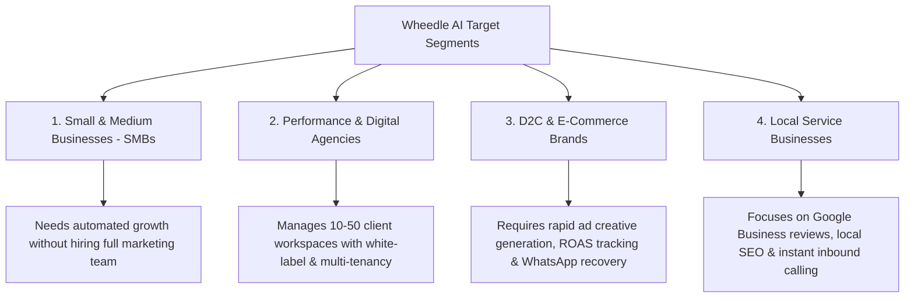
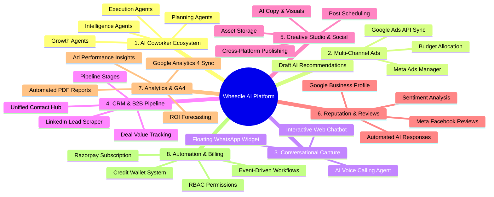
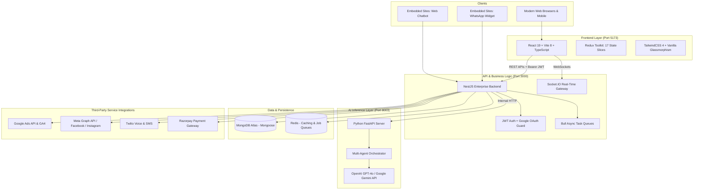
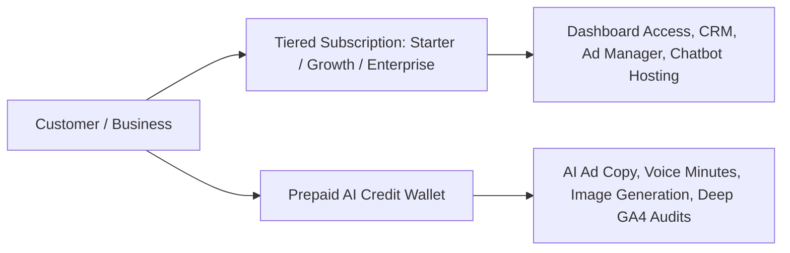
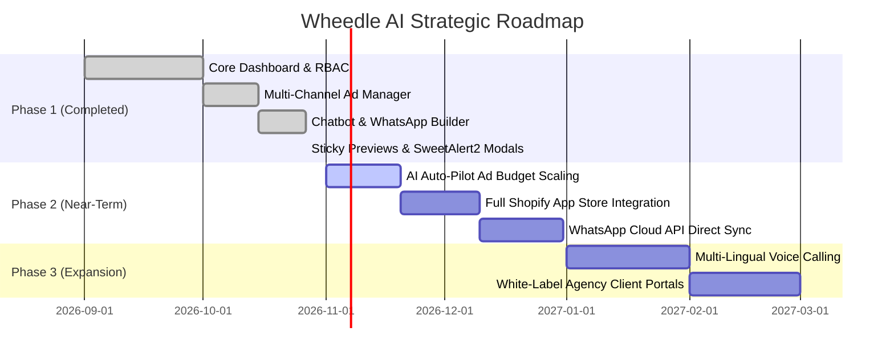

# 🎯 Wheedle AI — Complete Product Vision, Target & Strategic Architecture Document

---

## 1. Executive Summary & Core Mission

**Wheedle AI** (AI Digital Marketing Platform V2) is an **Autonomous All-in-One AI Marketing & Revenue Operating System**. 

### 🌟 The Core Mission
> *"To replace fragmented, expensive digital marketing toolchains and human agency overhead by providing businesses with an autonomous, 24/7 AI-powered marketing coworker ecosystem that handles brand discovery, multi-channel ad management, lead capture, CRM pipeline, social publishing, voice calling, and reputation intelligence under one unified platform."*

* **Platform Brand:** Wheedle Technologies / Wheedle AI
* **Live Production URL:** [wheedletechnologies.tech](https://wheedletechnologies.tech)
* **Core Paradigm:** **Human-in-the-Loop Autonomous Marketing** — The platform enables business owners and marketers to supervise AI agents that plan, produce, launch, analyze, and convert traffic automatically.

---

## 2. Market Problem & Why This Project Exists

Traditional digital marketing is fundamentally broken for modern businesses due to severe fragmentation and prohibitive costs:

| Traditional Challenge | The Pain Point | How Wheedle AI Solves It |
|---|---|---|
| **Tool Sprawl (SaaS Fatigue)** | Businesses use 8–12 disconnected tools (HubSpot, Hootsuite, Jasper, ManyChat, Google Ads, Meta Ads Manager, Twilio, Birdeye). | **Unified Single-Pane Platform:** One dashboard replaces CRM, Ads, Chatbots, Calling, Social, SEO, and Reviews. |
| **High Agency Overhead** | Marketing agencies charge $3,000–$10,000/month with slow turnaround and opaque reporting. | **AI Agent Coworkers:** 24/7 autonomous agents analyze data, write copy, manage ad budgets, and engage leads at a fraction of the cost. |
| **Leaking Lead Funnels** | Website and social traffic arrives after hours or on weekends when human sales reps are offline. | **Always-On Lead Capture:** Interactive Web Chatbot, floating WhatsApp Widget, and AI Voice Calling engage and qualify leads in real time. |
| **Ad Spend Wastage** | SMBs waste 30–50% of ad budgets on Google and Meta due to poor bidding, unoptimized targeting, and lack of technical knowledge. | **AI Budget Optimizer & Draft Recs:** Automated ad spend auditing, bid adjustments, and predictive ROI modeling. |
| **Reputation Neglect** | Negative reviews on Google and Facebook go unnoticed, directly damaging local SEO and trust. | **Autonomous Review Agent:** Auto-scrapes, analyzes sentiment, and crafts personalized responses within minutes. |

---

## 3. Target Audience & Ideal Customer Profile (ICP)

Wheedle AI is engineered to target 4 primary customer tiers:

### 1. Small & Medium Enterprises (SMEs)
* **Profile:** 5–50 employees, lacks a dedicated in-house performance marketing team.
* **Goal:** Increase qualified leads and revenue without spending lakhs on agency retainers.
* **Key Modules Used:** Multi-channel Ads Manager, Web Chatbot, CRM, Google Business Reviews.

### 2. Digital Marketing & Growth Agencies
* **Profile:** Boutique agencies managing 10 to 50 client accounts.
* **Goal:** Scale client operations without proportional hiring; streamline client reporting and campaign launches.
* **Key Modules Used:** Multi-Brand Workspaces, Admin Impersonation, Presentation & Pitch Generator, Automated Reports.

### 3. D2C & E-Commerce Brands
* **Profile:** Online direct-to-consumer stores selling physical or digital products.
* **Goal:** Maximize ROAS (Return on Ad Spend), reduce abandoned carts, and drive conversational sales.
* **Key Modules Used:** Meta/Google Ads, Product Catalog sync, Floating WhatsApp AI Widget, Creative Hub.

### 4. Local Service Providers (Real Estate, Clinics, Salons, Education, Legal)
* **Profile:** High local competition where phone inquiries and local reputation dictate survival.
* **Goal:** Instant lead capture, review generation, and automated call qualification.
* **Key Modules Used:** AI Calling Agent (Twilio), WhatsApp Widget, Reputation & Review Inbox, Local SEO.

---

## 4. The 8 Core Functional Pillars

Wheedle AI is architected around 8 synergistic pillars:

### Pillar 1: Autonomous AI Coworkers & Agent Ecosystem
- **What it does:** Replaces static forms with autonomous AI agents specialized in specific marketing functions.
- **Agent Groups:**
  - **Planning Agents:** Market research, keyword strategy, competitor analysis.
  - **Execution Agents:** Ad creation, social media post writing, email drafting.
  - **Intelligence Agents:** Sentiment detection, anomaly alerts in ad spend, conversion tracking.
  - **Growth Agents:** A/B test suggestions, cross-channel budget rebalancing.

### Pillar 2: Unified Multi-Channel Ads Engine
- **What it does:** Centralizes Google Search/Display and Meta (Facebook/Instagram) advertising into a single dashboard.
- **Key Capabilities:**
  - One-click campaign deployment across Google and Meta.
  - Real-time spend, impression, CTR, CPC, and conversion analytics.
  - **Draft AI Recommendations:** The AI detects underperforming ad sets and generates ready-to-apply optimizations (budget shifts, negative keyword additions, audience refine).

### Pillar 3: Omnichannel Conversational Lead Capture
- **1. Web Chatbot Builder:** Custom branded AI chat agent embedded on any website via a 1-line `<script>` tag. Learns the brand's knowledge base and qualifies leads 24/7.
- **2. Floating WhatsApp Widget:** Interactive WhatsApp chat bubble for websites with 1-click preset templates (Support, Sales, Booking, Quotation), validation, and live mobile/desktop preview.
- **3. AI Voice Calling Agent:** Inbound and outbound calling agent powered by Twilio and conversational LLMs to qualify leads over the phone and update CRM records.

### Pillar 4: Unified CRM & LinkedIn B2B Pipeline
- **What it does:** Every lead captured from Ads, Chatbot, WhatsApp, or Calling flows automatically into a centralized CRM pipeline.
- **LinkedIn CRM:** Scrapes, enriches, and tracks high-value B2B prospects from LinkedIn to accelerate enterprise deal cycles.
- **Deal Tracking:** Contact stages (Lead → Contacted → Qualified → Closed), deal values, notes, and activity history.

### Pillar 5: AI Creative Workspace & Cross-Platform Publishing
- **What it does:** Generates high-converting marketing copy, headlines, hooks, and visual creatives in seconds.
- **Social Scheduling:** Multi-account social publishing across LinkedIn, Facebook, Instagram, and Twitter with an automated calendar view.

### Pillar 6: 360° Reputation & Review Intelligence
- **What it does:** Connects directly with Google Business Profiles and Meta Pages to aggregate customer reviews in real time.
- **Autonomous Review Agent:** Detects customer tone, alerts managers to negative feedback, and automatically drafts or posts personalized, brand-aligned responses.

### Pillar 7: Deep Analytics, GA4 Insights & Automated Reporting
- **What it does:** Direct integration with Google Analytics 4 (GA4) and ad APIs to evaluate true ROI.
- **Automated AI Briefings:** Daily and weekly summaries highlighting traffic spikes, conversion drop-offs, and tactical next steps.
- **Presentation Generator:** Auto-generates client-ready slides and PDF pitch decks.

### Pillar 8: Automation Workflows, RBAC & Wallet System
- **Event-Driven Workflows:** If a new lead arrives from WhatsApp → Send automated welcome email → Create CRM deal → Notify team via WebSocket.
- **Granular RBAC:** Roles (Superadmin, Admin, Marketer, Client Viewer) with strict permission gates.
- **Credit Wallet:** Pay-as-you-go credit system for AI generation and calling minutes, backed by Razorpay payments.

---

## 5. Technical Architecture & System Blueprint

The solution is built on an enterprise-grade 3-tier reactive architecture:

### Technical Highlights
1. **Frontend:** React 19, TypeScript, Redux Toolkit, TailwindCSS 4, Framer Motion, Recharts, SweetAlert2.
2. **Backend:** NestJS, TypeScript, Mongoose ODM, Passport JWT, Bull Queues, Socket.IO.
3. **AI Agents:** Python FastAPI, LangChain/LlamaIndex agents, Google Gemini & OpenAI LLMs.
4. **Data Layer:** MongoDB for schemaless flexibility; Redis for fast cache and queue persistence.

---

## 6. Competitive Differentiation & Positioning

| Capability | Wheedle AI | Traditional Marketing Agency | Single-Point SaaS (Jasper/HubSpot/ManyChat) |
|---|:---:|:---:|:---:|
| **Cost** | 💸 Low monthly SaaS + Usage credits | 💰 $3,000–$10,000/mo retainer | 💵 Multiple subscriptions ($500+/mo combined) |
| **All-in-One Integration** | ✅ Fully unified | ❌ Manual reports across tools | ❌ Disjointed tools requiring Zapier |
| **Response Time** | ⚡ Instant (<2 seconds) | ⏳ 24–48 hours turnaround | ⚡ Instant within silo |
| **Multi-Channel Ads + CRM** | ✅ Native Google + Meta + CRM | ⚠️ Depends on manual labor | ❌ Requires separate CRM & Ad platforms |
| **AI Voice Calling** | ✅ Built-in Twilio AI Agent | ❌ Needs separate call center | ❌ Not available |
| **WhatsApp AI Widget** | ✅ 1-Click Multi-platform embed | ❌ Manual developer work | ⚠️ Extra cost (ManyChat/Intercom) |
| **Autonomous Review Agent** | ✅ Scrapes & Replies 24/7 | ⚠️ Manual monitoring | ❌ Requires separate Birdeye/Podium |

---

## 7. Monetization & Business Model

Wheedle AI utilizes a hybrid **SaaS Subscription + Consumption Wallet** model:

1. **Monthly/Annual SaaS Subscription:**
   - **Starter ($49/mo):** 1 Workspace, 2 Chatbots, CRM up to 1,000 contacts, Ads Manager.
   - **Growth ($149/mo):** 5 Workspaces, Unlimited Chatbots & WhatsApp Widgets, Social Scheduler, AI Voice Calling.
   - **Agency / Enterprise ($399/mo):** Unlimited Workspaces, Multi-brand White-label, Team Roles & Permissions, Priority LLM inference.
2. **Usage-Based AI Credit Wallet:**
   - AI Image & Copy generation, Twilio voice minutes, and deep scrapers deduct credits from the user's prepaid wallet, recharged via Razorpay.

---

## 8. Strategic Product Roadmap

---

## 9. Conclusion

Wheedle AI is targeting the complete modernization of the digital marketing industry. By consolidating **Creative Generation, Ad Optimization, Conversational Lead Capture, Voice Calling, CRM, and Reputation Intelligence** into a single autonomous AI platform, it transforms marketing from a costly, fragmented chore into an automated, predictable revenue engine for businesses worldwide.
